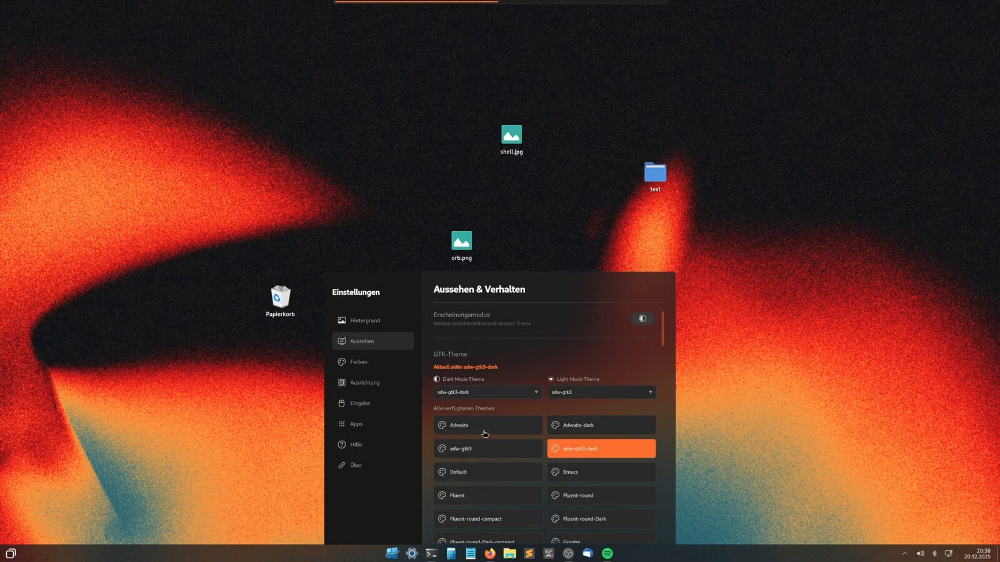

<div align="center">

# WinDoesNot

**Ein vertrauter Desktop. Ein freies System.**

Ein Linux-Desktop mit Startmenü, Taskleiste und Desktopsymbolen, die du sofort
wiedererkennst – auf Basis von [CachyOS](https://cachyos.org), [Hyprland](https://hypr.land)
und [Quickshell](https://quickshell.org).

[Website](https://windoesnot.me/) · [Hilfe](https://windoesnot.me/hilfe/) ·
[App-Store](https://github.com/Bennch/windoesnot-store) · [English](README.md)



</div>

> [!WARNING]
> **Erste öffentliche Vorschau: 0.1.0-18.** [ISO herunterladen](https://windoesnot.me/download/).
> Live-System und Installer sind in UEFI-VMs getestet; Tests auf echter Hardware stehen
> noch aus. Mit Ecken, Kanten und größeren Änderungen ist zu rechnen.

## Worum es geht

WinDoesNot begann Anfang 2025 als persönlicher Umstieg von Windows auf Linux und ist
zu einem eigenen Desktop gewachsen. Er ist für Menschen, die Linux ausprobieren und
ihre Gewohnheiten mitnehmen wollen – und für alle, die ihren Desktop selbst gestalten.

Dieses Repository enthält alles, um ihn zu bauen:

- den **Desktop** selbst (Quickshell-Oberfläche, Hyprland-Konfiguration, Plugins, Anmeldebildschirm),
- ein **Live-ISO** auf Basis des CachyOS-Live-Images mit angepasstem Calamares-Installer,
- Werkzeuge, um den Desktop **auf einem bestehenden System** zu installieren, ohne
  persönliche Daten anzufassen.

## Funktionen

**Desktop**
- Startmenü, zentrierte Taskleiste mit angehefteten Apps, Infobereich, Uhr und Kalender
- Frei platzierbare Desktopsymbole, Papierkorb, Drag & Drop
- Fenstertitelleisten mit Schließen/Maximieren, Einrast-Vorschau beim Ziehen
- Alt+Tab-Fensterwechsler und Arbeitsflächen-Übersicht
- Helles und dunkles Erscheinungsbild mit passenden GTK-Farben; Hintergrund und Akzentfarben
- Schnelleinstellungen für WLAN, Bluetooth und Audio, Wetter, Benachrichtigungen

**Einstellungen**
- Hintergrund, Aussehen, Farben, Ausrichtung, Eingabe, Monitore, Apps, Desktop
- **Updates**: anstehende Paketupdates, Arch-News (mit Warnung bei manuellem Eingriff),
  Hinweise auf Neustart/Neuanmeldung und ein optionaler AUR-Schalter
- **Sicherungen**: Btrfs-Snapshots mit eingebetteter Passwortabfrage
- Eingebaute Hilfe mit allen Tastenkürzeln

**Does** – ein optionales Assistenten-Panel für lokale Modelle (Ollama) oder
Cloud-Anbieter mit eigenem API-Schlüssel. Ohne Einrichtung wird nichts gesendet.

**[WinDoesNot Store](https://github.com/Bennch/windoesnot-store)** – ein GTK-App-Store für
pacman, AUR (standardmäßig aus) und Flatpak, mit einer Passwortabfrage pro Update und
Arch-News vor dem Systemupdate.

**Live-ISO und Installer**
- Offline-Installation (alles vom Medium) oder Online-Installation
- GRUB, Limine, rEFInd oder systemd-boot
- App-Auswahl während der Installation
- Ruhiger Startbildschirm mit Logo; die Fehlerkonsole öffnet sich automatisch oder mit Esc

## Stand

| Bereich | Stand |
|---|---|
| Desktop auf bestehendem Arch-/CachyOS-System | Vom Autor täglich genutzt |
| Live-Start, Offline-/Online-Installation, alle vier Bootloader | In QEMU (UEFI) getestet |
| Signierte Komponentenupdates | [Einmalige Einrichtung](UPDATE-CHANNEL.md#deutsch) · Update in einer UEFI-VM geprüft |
| Echte Hardware, BIOS-Start, Secure Boot, mehrere Monitore | **Noch nicht getestet** |
| Öffentlicher ISO-Download | [ISO 0.1.0-18](https://download.windoesnot.me/0.1.0-18/windoesnot-2026.10.24-x86_64.iso) · [SHA256](https://download.windoesnot.me/0.1.0-18/windoesnot-2026.10.24-x86_64.iso.sha256) |

## Bauen

Voraussetzungen auf einem Arch-basierten System: `archiso`, `arch-install-scripts`,
`squashfs-tools`, `grub`, `syslinux`, `xorriso`, `mtools`, `dosfstools`, Python mit
PyYAML, Git, QEMU und `edk2-ovmf`.

```sh
./build-and-run.sh                 # gepinnte Quellen holen, ISO bauen, in QEMU starten
./build-and-run.sh --build-only    # nur das ISO bauen
./build-and-run.sh --help          # alle Optionen (ohne Fenster, neue VM, installierte Platte, …)
```

Der Build läuft **ohne sudo** in User-Namespaces mit eigenem Paketcache und
Schlüsselbund (`--sudo-build` für Systeme ohne User-Namespaces). Pakete des Rechners
werden nie aktualisiert. Erzeugte Profile landen in `build/`, ISOs in `out/`,
VM-Platten in `vm/`.

Hyprland-Plugins und das eingebettete Terminalmodul werden gegen genau die Hyprland-
und Qt-Versionen im Image gebaut. Kopierte Binärdateien gelten nicht als portabel.

## Desktop auf einem bestehenden System installieren

> [!CAUTION]
> Gedacht für Arch-basierte Systeme mit installiertem Hyprland und Quickshell.
> Vorher ein Systembackup anlegen.

```sh
python3 tools/validate-desktop.py     # statische Prüfungen
sudo tools/install-system.sh          # Hilfsbefehle nach /usr/local/bin
python3 tools/install-user.py         # Probelauf: zeigt, was sich ändern würde
python3 tools/install-user.py --apply # für den aktuellen Benutzer installieren
```

Bestehende Einstellungen, angeheftete Apps, Monitoranordnung, Symbolpositionen, Chats
und Schlüssel bleiben erhalten. Jeder Lauf legt eine Dateisicherung unter
`~/Backups/windoesnot-release/` an.

## Aufbau des Repositorys

| Pfad | Inhalt |
|---|---|
| `desktop/` | Der Desktop: Quickshell, Hyprland-Konfiguration, Plugins (`hyprbars`, `hyprdrag`), snappy-switcher, SDDM-Theme, Hilfsskripte |
| `iso/` | Anpassung des Live-Images, Installer-Module, Softwarekatalog, Startbildschirm |
| `packaging/` | PKGBUILD-Vorlage, Version und Changelog |
| `tools/` | Werkzeuge für Build, Pakete, Prüfungen, VMs und Host-Abgleich |
| `tests/` | Automatische Tests |
| `docs/screenshots/` | Screenshots für diese README |
| `sources.json` | Gepinnte Upstream-Quellen (CachyOS-Live-ISO, Calamares, snappy-switcher, Store) |

Upstream-Checkouts werden nie direkt verändert; alle Änderungen liegen in diesem
Repository und werden beim Erzeugen des Profils angewendet.

## Mitmachen

Du möchtest die Vorschau ausprobieren? [Hier steht der kurze Testablauf](CONTRIBUTING.md#deutsch).
[Melde dein Hardware-Ergebnis](https://github.com/Bennch/windoesnot/issues/new?template=hardware_test.yml)
oder [beschreibe einen Fehler](https://github.com/Bennch/windoesnot/issues/new?template=bug_report.yml).
Deutsch und Englisch sind willkommen.

Fehlermeldungen und Ideen sind willkommen. Das Projekt wird von einer Person mit Hilfe
von KI-Programmieragenten (Claude Code und Codex) entwickelt.

## Lizenz

WinDoesNot ist freie Software unter der [GNU General Public License v3.0 oder später](LICENSE).
Mitgelieferte Fremdkomponenten behalten ihre eigenen Lizenzen; siehe
[THIRD-PARTY.md](THIRD-PARTY.md).

WinDoesNot ist ein unabhängiges Community-Projekt und steht in keiner Verbindung zu
Microsoft. Windows ist eine Marke der Microsoft-Unternehmensgruppe.
