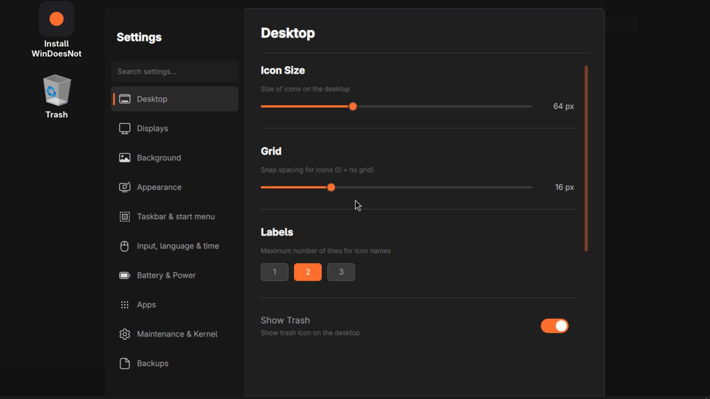
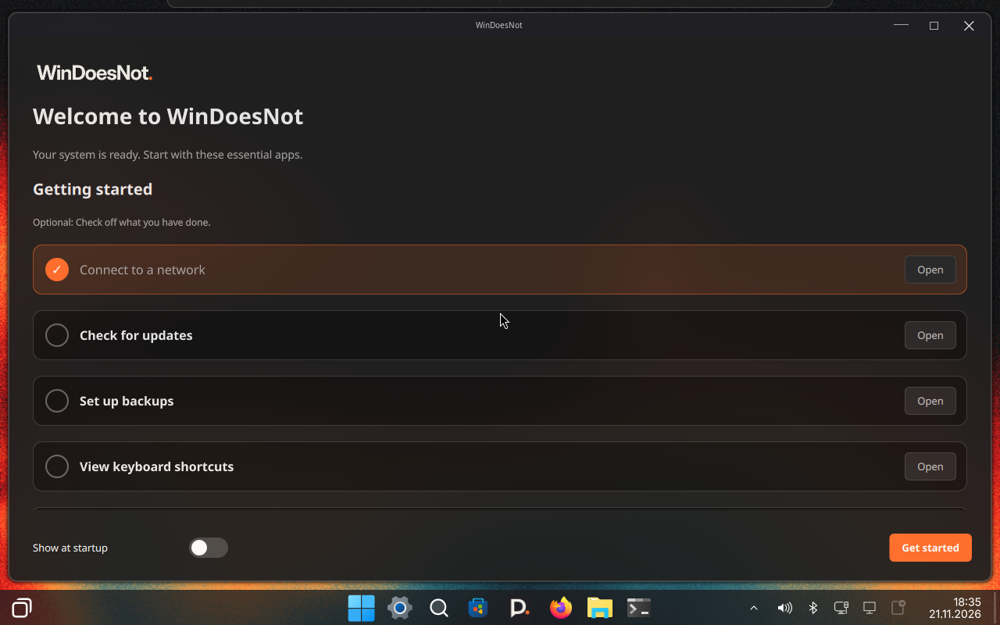

<div align="center">

<h1>
<picture>
  <source media="(prefers-color-scheme: dark)" srcset="desktop/config/quickshell/default/img/brand/windoesnot-logo-hell.png">
  
</picture>
</h1>

**Ein vertrauter Desktop. Ein freies System.**

Ein Linux-Desktop mit Startmenü, Taskleiste und Desktopsymbolen, die du sofort
wiedererkennst – auf Basis von [CachyOS](https://cachyos.org), [Hyprland](https://hypr.land)
und [Quickshell](https://quickshell.org).

[Website](https://windoesnot.me/) · [Hilfe](https://windoesnot.me/hilfe/) ·
[App-Store](https://github.com/Bennch/windoesnot-store) · [English](README.md)



</div>

> [!WARNING]
> **Version 0.1.0-33.** [ISO herunterladen](https://windoesnot.me/download/).
> Getestet in UEFI-VMs und auf einem Laptop von 2010 (BIOS-Start). Secure Boot und AMD-Grafik sind noch nicht getestet.

## Worum es geht

WinDoesNot begann Anfang 2025 als persönlicher Umstieg von Windows auf Linux und ist
zu einem eigenen Desktop gewachsen. Er ist für Menschen, die Linux ausprobieren und
ihre Gewohnheiten mitnehmen wollen – und für alle, die ihren Desktop selbst gestalten.

Dieses Repository enthält alles, um ihn zu bauen:

- den **Desktop** selbst (Quickshell-Oberfläche, Hyprland-Konfiguration, Plugins, Anmeldebildschirm),
- ein **Live-ISO** auf Basis des CachyOS-Live-Images mit angepasstem Calamares-Installer,
- Werkzeuge, um den Desktop **auf einem bestehenden System** zu installieren, ohne
  persönliche Daten anzufassen.

## Funktionen

**Desktop**
- Startmenü mit Suche (Dateien, Apps, Rechner, Emoji), mittige Taskleiste mit angehefteten Apps, Infobereich, Uhr und Kalender mit Feiertagen
- Kachel- oder Floating-Fenster, mit Snapping und Layouts am Maximieren-Knopf (wie unter Windows 11)
- Desktop-Symbole frei platzierbar, Papierkorb, Drag & Drop; Symbole mit Super + Umschalt + D ausblenden
- Fenstertitel mit Knöpfen, Alt+Tab, Arbeitsflächen-Übersicht; Web-Apps im eigenen Fenster
- Hell und Dunkel mit passenden GTK-Farben, Akzentfarbe, Eckenradius, Hintergrund; eigene Looks speichern
- Schnelleinstellungen für WLAN, Bluetooth (mit Standardgerät), Ton, Wetter und Benachrichtigungen
- Lite-Modus für ältere Rechner und geringere Grundlast auf schwacher Hardware

**Einstellungen**
- Aussehen, Farben, Eingabe, Monitore, Apps, Desktop, Netzwerk, Bluetooth, Ton und mehr
- **Barrierefreiheit**: Lupe, Farbfilter (auch für Farbfehlsichtigkeit und hohen Kontrast), Zeiger- und Textgröße, weniger Bewegung
- **Umzug von Windows**: findet Profile, Passwörter, Einstellungen und Projekte; du bestätigst Schritt für Schritt, was mitkommt. Umzugspakete auf einer externen Platte oder im Netzwerk
- **Dateisicherung**: Kopien deines persönlichen Ordners auf Platte oder Netzwerkfreigabe, mit Aufbewahrung und Wiederherstellung (die ersetzte Datei landet im Papierkorb)
- **Firewall** mit Profilen (Zuhause, Öffentlich, Nur vertrauenswürdig) und erklärten Ports
- **Diagnose** und Gerätekarte mit Empfehlung, Bericht ohne persönliche Daten
- **Updates**: ausstehende Paket-Updates, Arch-Nachrichten, Hinweise zu Neustart und Neuanmeldung
- Eingebaute Hilfe mit allen Tastenkürzeln

**Dateimanager**
- **Dieser PC** mit Laufwerken in Kategorien und Füllbalken; die Systemplatte erscheint einmal
- Freigaben im Netzwerk (Samba) für Windows und Mac; Rechtsklick-Aktionen und „Senden an“

**[WinDoesNot Store](https://github.com/Bennch/windoesnot-store)** — ein GTK-App-Store für
pacman, AUR (standardmäßig aus) und Flatpak, mit Entfernungsvorschau und einer Passwortabfrage pro Update.

**Does** — ein optionales Assistenten-Panel, das mit lokalen Modellen (Ollama) oder Cloud-Anbietern
mit eigenem API-Schlüssel sprechen kann. Ohne deine Einrichtung wird nichts gesendet.

**Live-ISO und Installer**
- Offline-Installation (alles vom Datenträger) oder Online-Installation
- GRUB, Limine, rEFInd oder systemd-boot; Installation neben einem bestehenden Windows
- Programmauswahl bei der Installation (auch Emulatoren und Entwicklungswerkzeuge)
- Ruhiger Startbildschirm mit Logo; die Fehlerkonsole öffnet sich automatisch oder mit Esc

## Stand

| Bereich | Stand |
|---|---|
| Desktop auf bestehendem Arch-/CachyOS-System | Vom Autor täglich genutzt |
| Live-Start, Offline-/Online-Installation, alle vier Bootloader | In QEMU (UEFI) getestet |
| Signierte Komponentenupdates | [Einmalige Einrichtung](UPDATE-CHANNEL.md#deutsch) · Update in einer UEFI-VM geprüft |
| Echte Hardware: BIOS-Start, alte CPU und Grafik (Laptop von 2010, Leichtmodus), Rechner des Autors mit mehreren Monitoren | Getestet |
| Secure Boot, AMD-Grafik, andere Laptops | **Noch nicht getestet** |
| Öffentlicher ISO-Download | [Download-Seite](https://windoesnot.me/download/) · aktuelle Version 0.1.0-33 |

## Bauen

Voraussetzungen auf einem Arch-basierten System: `archiso`, `arch-install-scripts`,
`squashfs-tools`, `grub`, `syslinux`, `xorriso`, `mtools`, `dosfstools`, Python mit
PyYAML, Git, QEMU und `edk2-ovmf`.

```sh
./build-and-run.sh                 # gepinnte Quellen holen, ISO bauen, in QEMU starten
./build-and-run.sh --build-only    # nur das ISO bauen
./build-and-run.sh --help          # alle Optionen (ohne Fenster, neue VM, installierte Platte, …)
```

Der Build läuft **ohne sudo** in User-Namespaces mit eigenem Paketcache und
Schlüsselbund (`--sudo-build` für Systeme ohne User-Namespaces). Pakete des Rechners
werden nie aktualisiert. Erzeugte Profile landen in `build/`, ISOs in `out/`,
VM-Platten in `vm/`.

Hyprland-Plugins und das eingebettete Terminalmodul werden gegen genau die Hyprland-
und Qt-Versionen im Image gebaut. Kopierte Binärdateien gelten nicht als portabel.

## Desktop auf einem bestehenden System installieren

> [!CAUTION]
> Gedacht für Arch-basierte Systeme mit installiertem Hyprland und Quickshell.
> Vorher ein Systembackup anlegen.

```sh
python3 tools/validate-desktop.py     # statische Prüfungen
sudo tools/install-system.sh          # Hilfsbefehle nach /usr/local/bin
python3 tools/install-user.py         # Probelauf: zeigt, was sich ändern würde
python3 tools/install-user.py --apply # für den aktuellen Benutzer installieren
```

Bestehende Einstellungen, angeheftete Apps, Monitoranordnung, Symbolpositionen, Chats
und Schlüssel bleiben erhalten. Jeder Lauf legt eine Dateisicherung unter
`~/Backups/windoesnot-release/` an.

## Aufbau des Repositorys

| Pfad | Inhalt |
|---|---|
| `desktop/` | Der Desktop: Quickshell, Hyprland-Konfiguration, Plugins (`hyprbars`, `hyprdrag`), snappy-switcher, SDDM-Theme, Hilfsskripte |
| `iso/` | Anpassung des Live-Images, Installer-Module, Softwarekatalog, Startbildschirm |
| `packaging/` | PKGBUILD-Vorlage, Version und Changelog |
| `tools/` | Werkzeuge für Build, Pakete, Prüfungen, VMs und Host-Abgleich |
| `tests/` | Automatische Tests |
| `docs/screenshots/` | Screenshots für diese README |
| `sources.json` | Gepinnte Upstream-Quellen (CachyOS-Live-ISO, Calamares, snappy-switcher, Store) |

Upstream-Checkouts werden nie direkt verändert; alle Änderungen liegen in diesem
Repository und werden beim Erzeugen des Profils angewendet.

## Mitmachen

Du möchtest die Vorschau ausprobieren? [Hier steht der kurze Testablauf](CONTRIBUTING.md#deutsch).
[Melde dein Hardware-Ergebnis](https://github.com/Bennch/windoesnot/issues/new?template=hardware_test.yml)
oder [beschreibe einen Fehler](https://github.com/Bennch/windoesnot/issues/new?template=bug_report.yml).
Deutsch und Englisch sind willkommen.
Was bisher getestet ist, zeigt die [Hardware-Kompatibilitätsmatrix](docs/HARDWARE.md) (englisch).

Fehlermeldungen und Ideen sind willkommen. Das Projekt wird von einer Person mit Hilfe
von KI-Programmieragenten (Claude Code und Codex) entwickelt.

## Lizenz

WinDoesNot ist freie Software unter der [GNU General Public License v3.0 oder später](LICENSE).
Mitgelieferte Fremdkomponenten behalten ihre eigenen Lizenzen; siehe
[THIRD-PARTY.md](THIRD-PARTY.md).

WinDoesNot ist ein unabhängiges Community-Projekt und steht in keiner Verbindung zu
Microsoft. Windows ist eine Marke der Microsoft-Unternehmensgruppe.

## Willkommen beim ersten Start

Der erste Start bietet direkten Zugriff auf Store, Geräte-Manager,
Einstellungen, Dateien, Standardbrowser und Terminal. Oben stellst du Auflösung,
Zoom und Mausgeschwindigkeit ein. Darunter stehen die Einrichtungshinweise
für den Rechner.



[Helle Ansicht](docs/screenshots/welcome-light.png) ·
[WinDoesNot Geräte-Manager](https://github.com/Bennch/windoesnot-device-manager)
