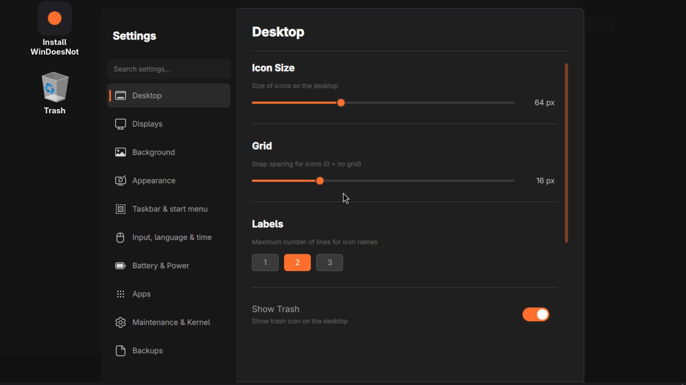
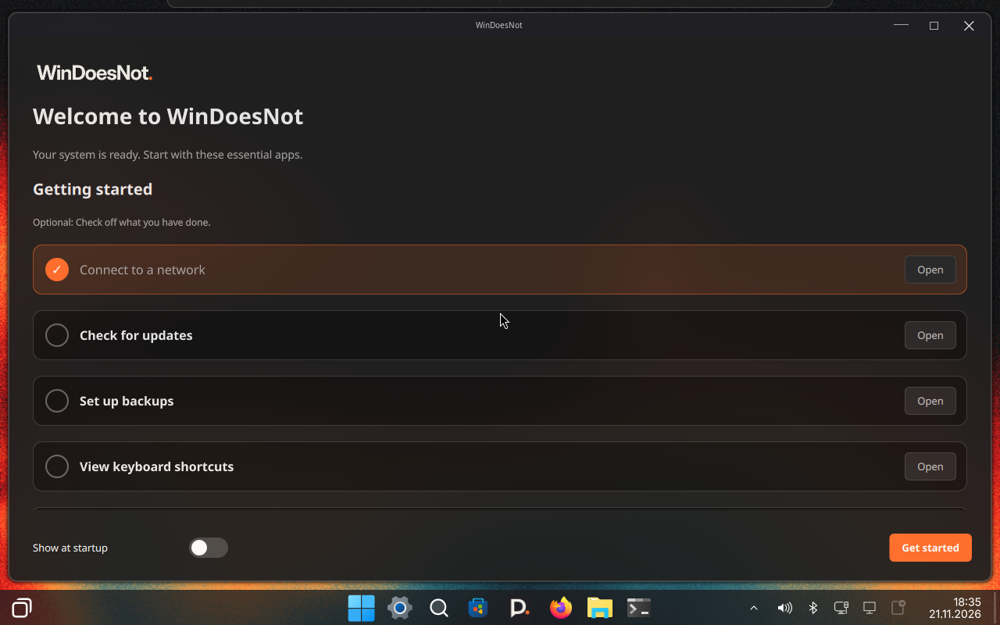

<div align="center">

<h1>
<picture>
  <source media="(prefers-color-scheme: dark)" srcset="desktop/config/quickshell/default/img/brand/windoesnot-logo-hell.png">
  
</picture>
</h1>

**A familiar desktop. A free system.**

A Linux desktop with a start menu, taskbar and desktop icons you recognize right away,
built on [CachyOS](https://cachyos.org), [Hyprland](https://hypr.land) and
[Quickshell](https://quickshell.org).

[Website](https://windoesnot.me/en/) · [Help & docs](https://windoesnot.me/en/help/) ·
[App store](https://github.com/Bennch/windoesnot-store) · [Deutsch](README.de.md)



</div>

> [!WARNING]
> **Version 0.1.0-33.** [Download the ISO](https://windoesnot.me/en/download/).
> Tested in UEFI virtual machines and on a 2010 laptop (BIOS boot). Secure Boot and AMD graphics are not tested yet.

## What it is

WinDoesNot started in early 2025 as a personal switch from Windows to Linux and grew
into its own desktop. It is for people who are curious about Linux and want to keep
their habits, and for everyone who likes to shape their own desktop.

This repository contains everything needed to build it:

- the **desktop** itself (Quickshell shell, Hyprland configuration, plugins, login theme),
- a **live ISO** based on the CachyOS live image, with a customized Calamares installer,
- tools to **install the desktop on an existing system** without touching personal data.

## Features

**Desktop**
- Start menu with search (files, apps, calculator, emoji), centered taskbar with pinned apps, system tray, clock and calendar with holidays
- Tiling or floating windows, with snapping and layouts on the maximize button (like Windows 11)
- Desktop icons you can place freely, recycle bin, drag and drop, hide them with Super + Shift + D
- Window title bars, Alt+Tab, workspace overview; web apps in their own window
- Light and dark appearance with matching GTK colors, accent colour, corner radius and wallpaper; saved looks
- Quick settings with Wi-Fi, Bluetooth (with a default device), audio, weather and notifications
- Lite mode for older computers, and a lighter background load on weak hardware

**Settings app**
- Appearance, colours, input, monitors, apps, desktop, network, Bluetooth, sound and more
- **Accessibility**: magnifier, colour filters (including colour blindness and high contrast), cursor and text size, less motion
- **Moving from Windows**: finds profiles, passwords, settings and projects, you confirm step by step what comes along; transfer packages on an external disk or a network share
- **Backups**: copies of your home folder to a disk or a network share, with retention and restore (a replaced file goes to the trash)
- **Firewall** with profiles (home, public, trusted only) and open ports explained
- **Diagnosis** and a device overview with a recommendation, a report without personal data
- **Updates**: pending package updates, Arch news, reboot and re-login hints
- Built-in help with all keyboard shortcuts

**File manager**
- **This PC** with drives in categories and fill bars; the system disk appears once
- Share folders in the network (Samba) for Windows and Mac; right-click and send-to actions

**[WinDoesNot Store](https://github.com/Bennch/windoesnot-store)** — a GTK app store for
pacman, AUR (off by default) and Flatpak, with a removal preview and one password prompt per update.

**Does** — an optional assistant panel that can talk to local models (Ollama) or
cloud providers with your own API key. Nothing is sent anywhere unless you set it up.

**Live ISO and installer**
- Offline installation (everything from the medium) or online installation
- GRUB, Limine, rEFInd or systemd-boot; installation next to an existing Windows
- App selection during installation (including emulators and development tools)
- Quiet boot screen with logo; the error console opens automatically or with Esc

## First-run welcome

The first start offers a checklist for connecting to a network, checking updates,
setting up backups and exploring keyboard shortcuts. The welcome window also
provides access to common applications and setup information.



[Light appearance](docs/screenshots/welcome-light.png) ·
[WinDoesNot Device Manager](https://github.com/Bennch/windoesnot-device-manager)

## Status

| Area | State |
|---|---|
| Desktop on an existing Arch/CachyOS system | Used daily by the author |
| Live boot, offline/online install, all four bootloaders | Tested in QEMU (UEFI) |
| Signed component updates | [One-time setup](UPDATE-CHANNEL.md) · upgrade checked in a UEFI VM |
| Real hardware: BIOS boot, old CPU and graphics (2010 laptop, light mode), author's PC with several monitors | Tested |
| Secure Boot, AMD graphics, other laptops | **Not tested yet** |
| Public ISO download | [Download page](https://windoesnot.me/en/download/) · current version 0.1.0-33 |

## Building

Requirements on an Arch-based host: `archiso`, `arch-install-scripts`,
`squashfs-tools`, `grub`, `syslinux`, `xorriso`, `mtools`, `dosfstools`, Python with
PyYAML, Git, QEMU and `edk2-ovmf`.

```sh
./build-and-run.sh                 # fetch pinned sources, build the ISO, boot it in QEMU
./build-and-run.sh --build-only    # only build the ISO
./build-and-run.sh --help          # all options (headless, fresh VM, installed disk, …)
```

The build runs **without sudo** in user namespaces with its own package cache and
keyring (`--sudo-build` exists for hosts without user namespaces). It never updates
host packages. Generated profiles go to `build/`, ISOs to `out/`, VM disks to `vm/`.

Hyprland plugins and the embedded terminal module are compiled against the exact
Hyprland and Qt versions inside the image. Copied binaries are not assumed to be
portable.

## Installing the desktop on an existing system

> [!CAUTION]
> This targets Arch-based systems with Hyprland and Quickshell installed. Make a
> system backup first.

```sh
python3 tools/validate-desktop.py     # static checks
sudo tools/install-system.sh          # helper commands in /usr/local/bin
python3 tools/install-user.py         # dry run: shows what would change
python3 tools/install-user.py --apply # install for the current user
```

Existing settings, pinned apps, monitor layout, icon positions, chats and keys are
preserved. Every run creates a file backup under `~/Backups/windoesnot-release/`.

## Repository layout

| Path | Contents |
|---|---|
| `desktop/` | The desktop: Quickshell config, Hyprland config, plugins (`hyprbars`, `hyprdrag`), snappy-switcher, SDDM theme, helper scripts |
| `iso/` | Live image customization, installer modules, software catalog, boot splash |
| `packaging/` | PKGBUILD template, version and changelog |
| `tools/` | Build, packaging, validation, VM and host-sync tools |
| `tests/` | Automated tests |
| `docs/screenshots/` | Screenshots for this README |
| `sources.json` | Pinned upstream sources (CachyOS live ISO, Calamares, snappy-switcher, store) |

Upstream checkouts are never modified in place; all changes live in this repository
and are applied when the profile is generated.

## Contributing

Want to try the preview? [Start with the short testing guide](CONTRIBUTING.md),
[share your hardware result](https://github.com/Bennch/windoesnot/issues/new?template=hardware_test.yml)
or [report a bug](https://github.com/Bennch/windoesnot/issues/new?template=bug_report.yml).
English and German are both welcome.

Issues and ideas are welcome. The project is developed by one person with the help
of AI coding agents (Claude Code and Codex).

## License

WinDoesNot is free software under the [GNU General Public License v3.0 or later](LICENSE).
Bundled third-party components keep their own licenses; see
[THIRD-PARTY.md](THIRD-PARTY.md).

WinDoesNot is an independent community project and is not affiliated with Microsoft.
Windows is a trademark of the Microsoft group of companies.
