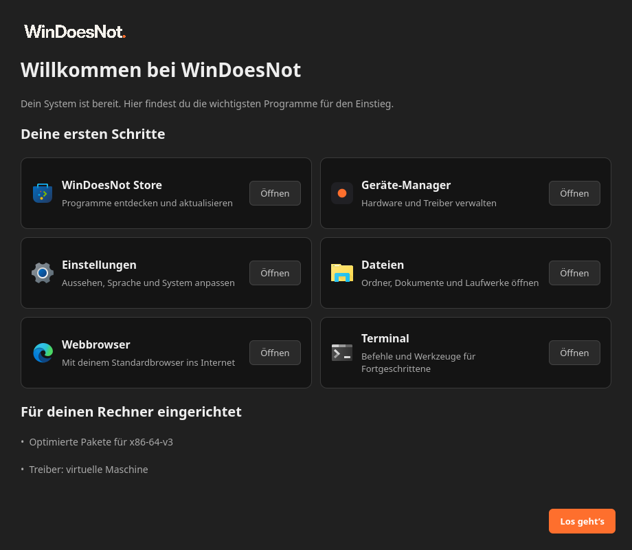

<div align="center">

# WinDoesNot

**A familiar desktop. A free system.**

A Linux desktop with a start menu, taskbar and desktop icons you recognize right away,
built on [CachyOS](https://cachyos.org), [Hyprland](https://hypr.land) and
[Quickshell](https://quickshell.org).

[Website](https://windoesnot.me/en/) · [Help & docs](https://windoesnot.me/en/help/) ·
[App store](https://github.com/Bennch/windoesnot-store) · [Deutsch](README.de.md)


</div>

> [!WARNING]
> **First public preview: 0.1.0-18.** [Download the ISO](https://windoesnot.me/en/download/).
> The live system and installer are tested in UEFI virtual machines; tests on real
> hardware are still open. Expect rough edges and breaking changes.

## What it is

WinDoesNot started in early 2025 as a personal switch from Windows to Linux and grew
into its own desktop. It is for people who are curious about Linux and want to keep
their habits, and for everyone who likes to shape their own desktop.

This repository contains everything needed to build it:

- the **desktop** itself (Quickshell shell, Hyprland configuration, plugins, login theme),
- a **live ISO** based on the CachyOS live image, with a customized Calamares installer,
- tools to **install the desktop on an existing system** without touching personal data.

## Features

**Desktop**
- Start menu, centered taskbar with pinned apps, system tray, clock and calendar
- Desktop icons you can place freely, recycle bin, drag and drop
- Window title bars with close/maximize buttons, snap preview when dragging windows
- Alt+Tab window switcher and workspace overview
- Light and dark appearance with matching GTK colors; wallpaper and accent colors
- Quick settings with Wi-Fi, Bluetooth and audio, weather, notifications

**Settings app**
- Background, appearance, colors, alignment, input, monitors, apps, desktop
- **Updates**: pending package updates, Arch news (with a warning for manual
  interventions), reboot/re-login hints and an optional AUR switch
- **Backups**: Btrfs snapshots with an embedded password prompt
- Built-in help with all keyboard shortcuts

**Does** — an optional assistant panel that can talk to local models (Ollama) or
cloud providers with your own API key. Nothing is sent anywhere unless you set it up.

**[WinDoesNot Store](https://github.com/Bennch/windoesnot-store)** — a GTK app store for
pacman, AUR (off by default) and Flatpak, with one password prompt per update and
Arch news shown before system updates.

**Live ISO and installer**
- Offline installation (everything from the medium) or online installation
- GRUB, Limine, rEFInd or systemd-boot
- App selection during installation
- Quiet boot screen with logo; the error console opens automatically or with Esc

## First-run welcome

The next test ISO adds quick access to Store, Device Manager, Settings, Files,
your default browser and Terminal. The installed system's setup summary stays
below the shortcuts. These screenshots preview the new interface; the current
public ISO 0.1.0-18 does not include this screen yet.



[Light appearance](docs/screenshots/welcome-light.png) ·
[WinDoesNot Device Manager](https://github.com/Bennch/windoesnot-device-manager)

## Status

| Area | State |
|---|---|
| Desktop on an existing Arch/CachyOS system | Used daily by the author |
| Live boot, offline/online install, all four bootloaders | Tested in QEMU (UEFI) |
| Signed component updates | [One-time setup](UPDATE-CHANNEL.md) · upgrade checked in a UEFI VM |
| Real hardware, BIOS boot, Secure Boot, multi-monitor | **Not tested yet** |
| Public ISO download | [ISO 0.1.0-18](https://download.windoesnot.me/0.1.0-18/windoesnot-2026.10.24-x86_64.iso) · [SHA256](https://download.windoesnot.me/0.1.0-18/windoesnot-2026.10.24-x86_64.iso.sha256) |

## Building

Requirements on an Arch-based host: `archiso`, `arch-install-scripts`,
`squashfs-tools`, `grub`, `syslinux`, `xorriso`, `mtools`, `dosfstools`, Python with
PyYAML, Git, QEMU and `edk2-ovmf`.

```sh
./build-and-run.sh                 # fetch pinned sources, build the ISO, boot it in QEMU
./build-and-run.sh --build-only    # only build the ISO
./build-and-run.sh --help          # all options (headless, fresh VM, installed disk, …)
```

The build runs **without sudo** in user namespaces with its own package cache and
keyring (`--sudo-build` exists for hosts without user namespaces). It never updates
host packages. Generated profiles go to `build/`, ISOs to `out/`, VM disks to `vm/`.

Hyprland plugins and the embedded terminal module are compiled against the exact
Hyprland and Qt versions inside the image. Copied binaries are not assumed to be
portable.

## Installing the desktop on an existing system

> [!CAUTION]
> This targets Arch-based systems with Hyprland and Quickshell installed. Make a
> system backup first.

```sh
python3 tools/validate-desktop.py     # static checks
sudo tools/install-system.sh          # helper commands in /usr/local/bin
python3 tools/install-user.py         # dry run: shows what would change
python3 tools/install-user.py --apply # install for the current user
```

Existing settings, pinned apps, monitor layout, icon positions, chats and keys are
preserved. Every run creates a file backup under `~/Backups/windoesnot-release/`.

## Repository layout

| Path | Contents |
|---|---|
| `desktop/` | The desktop: Quickshell config, Hyprland config, plugins (`hyprbars`, `hyprdrag`), snappy-switcher, SDDM theme, helper scripts |
| `iso/` | Live image customization, installer modules, software catalog, boot splash |
| `packaging/` | PKGBUILD template, version and changelog |
| `tools/` | Build, packaging, validation, VM and host-sync tools |
| `tests/` | Automated tests |
| `docs/screenshots/` | Screenshots for this README |
| `sources.json` | Pinned upstream sources (CachyOS live ISO, Calamares, snappy-switcher, store) |

Upstream checkouts are never modified in place; all changes live in this repository
and are applied when the profile is generated.

## Contributing

Want to try the preview? [Start with the short testing guide](CONTRIBUTING.md),
[share your hardware result](https://github.com/Bennch/windoesnot/issues/new?template=hardware_test.yml)
or [report a bug](https://github.com/Bennch/windoesnot/issues/new?template=bug_report.yml).
English and German are both welcome.

Issues and ideas are welcome. The project is developed by one person with the help
of AI coding agents (Claude Code and Codex).

## License

WinDoesNot is free software under the [GNU General Public License v3.0 or later](LICENSE).
Bundled third-party components keep their own licenses; see
[THIRD-PARTY.md](THIRD-PARTY.md).

WinDoesNot is an independent community project and is not affiliated with Microsoft.
Windows is a trademark of the Microsoft group of companies.
