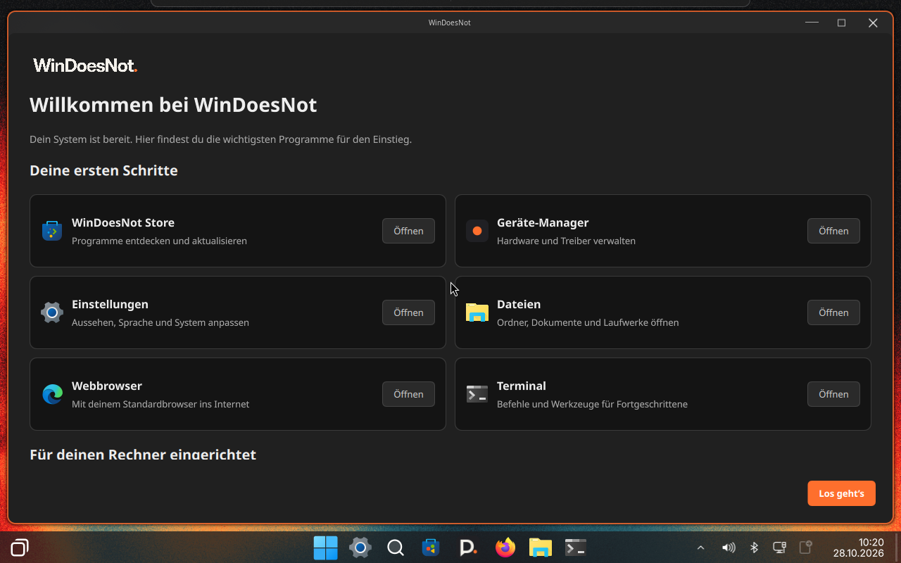

# Test ISO 0.1.0-20-rc1

This is a test candidate. The regular website download and signed update channel
remain on their existing versions until testing is complete.

- [Download the test ISO](https://download.windoesnot.me/testing/0.1.0-20-rc1/windoesnot-0.1.0-20-rc1-x86_64.iso)
- [SHA256 checksum file](https://download.windoesnot.me/testing/0.1.0-20-rc1/windoesnot-0.1.0-20-rc1-x86_64.iso.sha256)
- Size: **4,969,799,680 bytes** (approximately 4.97 GB).

```text
f598a588a29490c3415473841934bc2caa619671c31b8fbc90fe0e5bf6656700
```

## Included

- Device Manager in the Start menu and directly below System in the Start
  button's right-click menu, with the Store's appearance and automatic theme.
- First-login welcome with direct access to six essential apps.
- LocalSend popup placement, shell selection, SDDM keyboard/language/time fixes,
  recovery controls and multilingual boot menus from the current sources.
- Installer guidance and reuse of a confirmed existing UEFI boot menu.

## Checked on this exact ISO

UEFI QEMU/KVM with VirGL graphics, 8 GB RAM and four virtual CPUs:

- Live boot, wallpaper, both desktop plugins and Store/Device Manager entries.
- Native Calamares offline installation: **44/44 jobs completed**, with the
  virtual network adapter disconnected during installation.
- GRUB, automatic Btrfs partitioning of a new empty virtual disk, recommended
  apps and the Fish shell selection.
- Boot from the installed disk with the ISO removed, normal SDDM login using
  Tab/Space, German interface and correct America/New_York local time.
- Automatic welcome, actual launch of Device Manager from its card, Store
  launch and the initial Btrfs recovery point. No failed system services or
  compositor configuration errors in the installed-system check.



[Actual login screen](docs/screenshots/test-iso20-login.png)

## Limits and useful feedback

- In the QEMU software-only graphics check, the upstream background service
  crashed; the desktop and installer still started. The successful full run
  used VirGL/3D graphics.
- Some inherited installer/boot labels still say `0.1-dev`; the desktop package
  build is **0.1.0-20**, Device Manager is **0.1.0-3**.
- Real hardware, BIOS, Secure Boot, all alternative bootloader paths and a new
  alongside installation were not retested on this candidate. Previous test
  results do not replace testing this image on your hardware.

When reporting results, include the candidate name, your VM/hardware and graphics
mode, install mode, bootloader and whether the first login succeeded. Use the
[GitHub issue forms](https://github.com/Bennch/windoesnot/issues).
